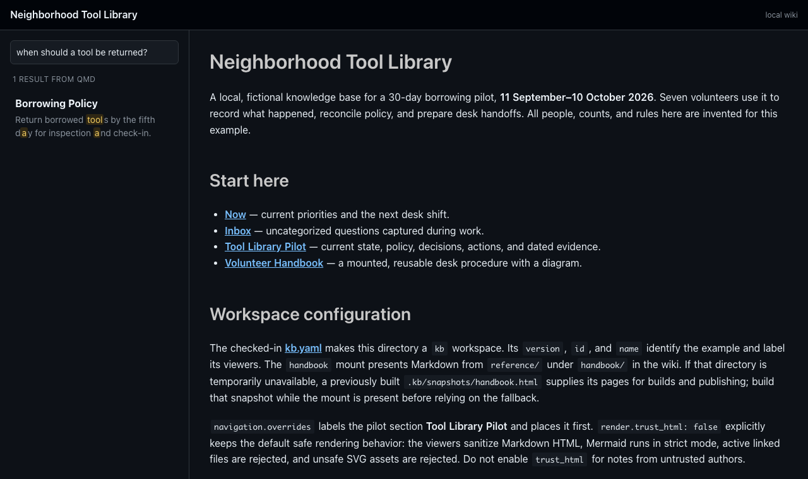

# Search

`kb` offers three kinds of search, from zero-setup to semantic.

## Keyword search: `kb find`

```sh
kb find "seven calendar days"
kb find --scope tool-library "reminder"
```

Searches Markdown directly, with no index, model, or network access.
`--scope` limits results to a path prefix.

## Browser search

Every viewer, including the single-file bundles, has ranked search over page
titles and content. Press Cmd/Ctrl+K to focus it and Escape to return to the
navigation. It works offline and needs no setup. Static sites and bundles always
use this search.

## Hybrid retrieval with qmd

For semantic and hybrid retrieval, `kb` delegates to
[qmd](https://github.com/tobi/qmd), a local search engine for Markdown. It is
optional; install it separately.

```sh
qmd init                                   # create the project's .qmd/ setup
qmd collection add . --name wiki           # index this workspace's Markdown
kb index                                   # qmd update + qmd embed
kb search --scope wiki "when is the day-five reminder sent?"
```

`qmd collection add` registers the workspace as the `wiki` collection in
`.qmd/index.yml`; `kb index` refuses to run until at least one collection
exists. Add `ignore` entries for generated output such as `.kb/**` and
`dist/**` there, since the static site contains copies of your pages. The
example workspace's
[`.qmd/index.yml`](https://github.com/ankurs/kb/blob/main/testdata/sample/.qmd/index.yml)
shows a complete configuration.

- `kb index` updates documents and generates embeddings. Models download
  once; `--force` re-embeds everything.
- `kb search` returns ranked documents and snippets, not a synthesized answer.
  `--scope` selects a qmd collection.
- `search.qmd_config` (default `.qmd`) is where the project's qmd
  configuration lives. Define collections in `.qmd/index.yml`.

When the project has a local `.qmd/index.sqlite` from `qmd init` and a
configured collection, `kb serve` starts its own private `qmd mcp --http`
process on a loopback port. The live viewer first shows immediate local
matches, then replaces them with qmd results. Short ASCII terms use fast keyword
retrieval; multiword or non-Latin queries use lexical + semantic retrieval
without LLM reranking. Only current, visible Markdown pages become links; stale or
out-of-workspace indexed hits are ignored. The qmd process stops with `kb serve`.
If qmd is missing, uninitialized, untrusted, or a query fails, browser search
continues without qmd. No qmd process starts during `kb build` or `kb publish`.
An index can download models when you first use hybrid search; `kb index`
prepares them in advance. `kb -v serve` shows whether qmd was enabled.



To let a coding agent use the same index, run qmd as an MCP server; see
[Use with coding agents](coding-agents.md#give-the-agent-semantic-search-with-qmd).

`kb doctor` reports a missing project configuration or empty collections. A
qmd configuration with update hooks, collection paths outside the project, or
custom models must be approved with `qmd trust`; `kb` never changes trust
settings for you.
