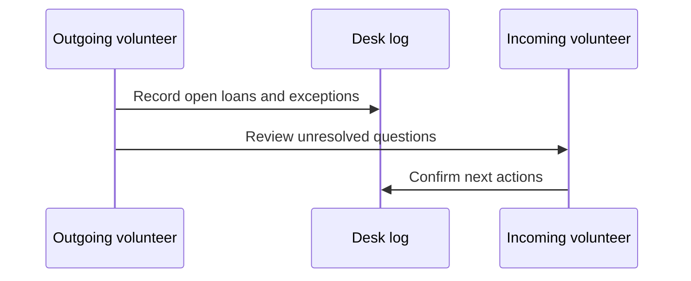

# Volunteer Shift Handoff

## Before leaving

- Reconcile open slips against the desk ledger.
- Put unresolved questions in the desk log with a date and next owner.
- Leave damaged tools apart from ready-to-lend stock.
- Hand the next volunteer a concise summary rather than an unverified rule.

## Handoff flow

The [check-in checklist](../check-in/README.md) covers an individual return; this page covers the transition between shifts.
