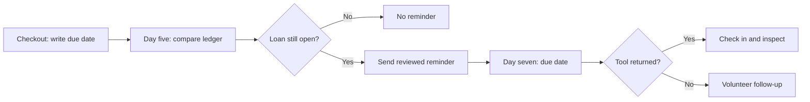

# Day-Five Reminder Workflow

> Current as of 2026-10-10. [D-02](../decisions.md#decision-log) approved one reminder during the pilot; [D-04](../decisions.md#decision-log) retained it without approving a second message.

## Purpose

Help borrowers notice their existing due date. A reminder does not change the [seven-day borrowing policy](borrowing-policy.md).

## Current workflow

1. On day five after checkout, compare the [loan ledger](../sources/README.md) with open slips.
2. For a loan that remains open, use the [reviewed message copy](../sources/reminder-copy.txt) and record that a reminder was sent.
3. At return, follow the [check-in checklist](../../handbook/check-in/README.md). An overdue or damaged return goes to a volunteer for review, not to an automatic penalty.

## Flow



## Desk checklist record

This is an illustrative YAML summary of [D-02](../decisions.md#decision-log), not an executable automation rule:

```yaml
pilot: tool-library
reminder_day: 5
send_if: loan_still_open
repeat: false
due_date_extension: false
```

## Evidence and limits

The [22 September review](../meetings/2026-09-22-reminder-trial.md) approved the single-message test. The [10 October metrics](pilot-metrics.md#10-october-snapshot) show 18 reminders and 17 timely returns among reminded matured loans; these observations do not prove a causal effect. Message wording and accessibility feedback should be revisited before wider use.
